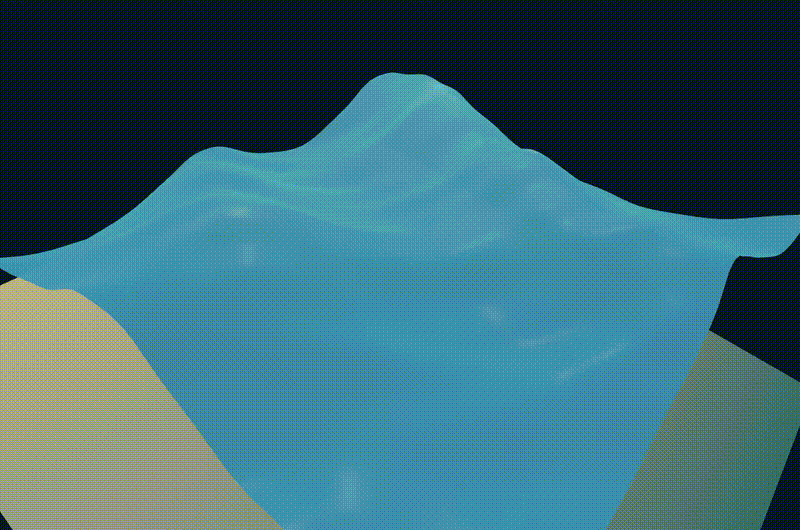
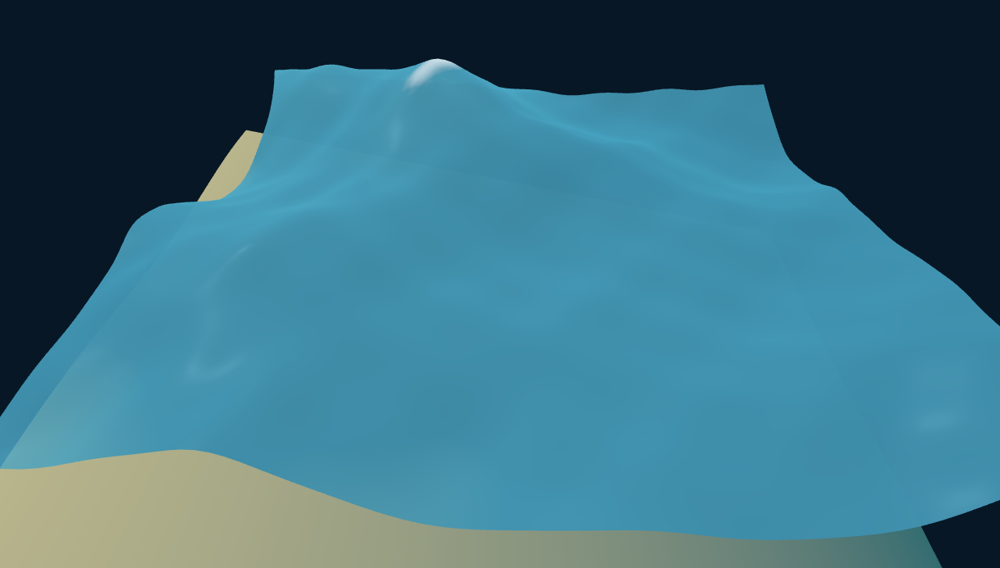
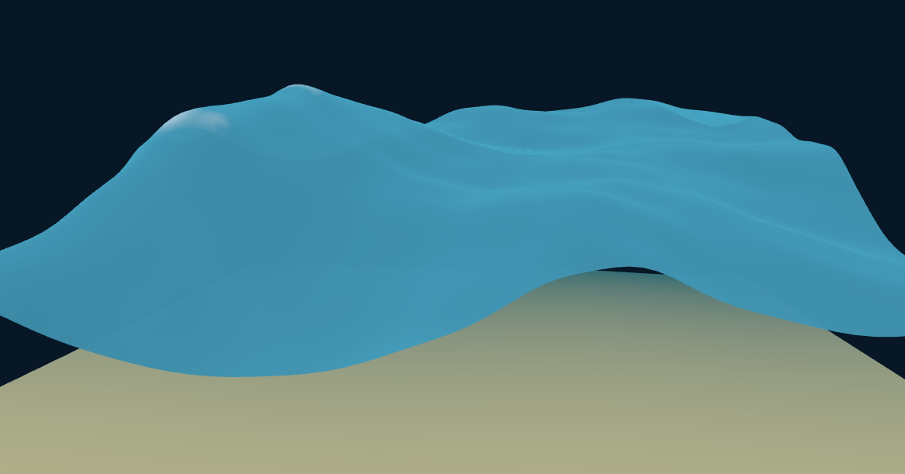
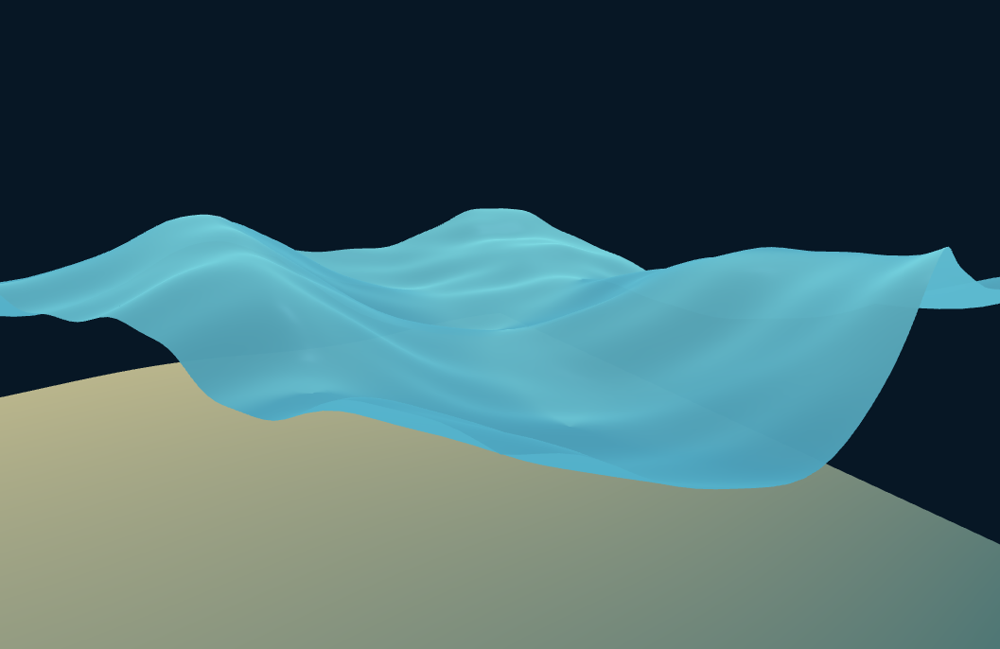

# Gerstner Wave Ocean Shader

A procedural ocean shader originally developed in **Godot 4**, using **Gerstner waves** for animated surface displacement, analytical derivatives for surface normals, and the **Jacobian determinant** to approximate foam formation in compressed regions of the water.

The shader also includes depth-dependent water color and transparency, view-dependent Fresnel reflections, and a stylized subsurface-scattering (SSS) effect. A small **Three.js** showcase demonstrates the effect outside Godot.



_Image 1: Low-res gif of the ocean shader_

## How to run

A lightweight browser demo is included to show the waves without launching the Godot game. It uses **Vite + Three.js** and deliberately contains no player physics or game-specific systems.

```bash
npm install
npm run dev
```

Open the local URL printed by Vite. **Left-drag** to orbit, **right-drag** to pan, and use the **mouse wheel** to zoom.

> **Rendering differences:** The browser shader reproduces the core wave and Jacobian calculations, but not Godot's full PBR material model. Its procedural reflections, sun glint, crest-biased foam, and depth prepass are showcase-specific approximations. The browser demo's stronger turquoise-green SSS color is an artistic adjustment, not a change to the underlying wave mathematics.

## Features

- **Six directional Gerstner waves** with configurable amplitudes, wavelengths, speeds, directions, and steepness.
- **Three additional detail waves** for smaller-scale displacement, surface-normal detail, and foam sensitivity.
- **Analytical surface normals**, approximated using partial derivatives of the wave height function rather than relying solely on mesh normals.
- **Jacobian-based foam** that responds to horizontal compression of the wave surface.
- **Depth-based coloration and transparency** to distinguish shallow water from deeper water and reveal the seabed.
- **Fresnel reflection tint** that changes with the viewing angle.
- **Stylized subsurface-scattering glow** on wave slopes, based on wave displacement, view direction, and sun direction.
- **Editable wave profiles** in Godot, with parameters passed to the shader from GDScript.
- **Browser showcase** in Three.js with orbit controls and a sloping seabed.

## How it works

### 1. Gerstner wave displacement

Each wave is defined by an amplitude $(A)$, wavelength $(\lambda)$, normalized horizontal direction $(\mathbf d)$, speed $(c)$, and steepness $(Q)$. Its wavenumber and phase are

$$
 k = \frac{2\pi}{\lambda}, \qquad
 \theta = k(\mathbf d\cdot\mathbf p + ct),
$$

where $(\mathbf p=(x,z))$ is the original horizontal vertex position. (The positive sign on $(ct)$ is the convention used in this implementation.)

For each main wave, the shader accumulates vertical displacement and a horizontal offset:

$$
 h \mathrel{+}= A\sin\theta,
 \qquad
 \mathbf D \mathrel{+}= QA\mathbf d\cos\theta.
$$

The final vertex position is approximately

$$
 \mathbf P'=(x+D_x,\;y+h,\;z+D_z).
$$

Summing waves with different directions and wavelengths produces a choppy, irregular surface without simulation grids or precomputed animation textures. The three short-wavelength detail waves additionally contribute height and derivatives, but **not horizontal vertex displacement** in this implementation.

### 2. Surface normals from derivatives

Rather than using the original flat plane normal, the shader accumulates the partial derivatives of wave height:

$$
 \frac{\partial h}{\partial x} = \sum_i A_i k_i d_{i,x}\cos\theta_i,
 \qquad
 \frac{\partial h}{\partial z} = \sum_i A_i k_i d_{i,z}\cos\theta_i.
$$

An approximate surface normal is then calculated as

$$
 \mathbf N \approx \mathrm{normalize}\left(-\frac{\partial h}{\partial x},\;1,\;-\frac{\partial h}{\partial z}\right).
$$

This captures changing wave slopes for lighting. It is an **approximation**: the exact Gerstner normal would also include derivatives of the horizontal displacement, for example by taking the cross product of the full displaced-surface tangents.

### 3. Foam from the Jacobian determinant

The foam is driven primarily by *horizontal surface compression*, rather than simply placing white foam at a particular wave height.

Let $(\mathbf D=(D_x,D_z))$ be the horizontal displacement field. The horizontal mapping is $(\mathbf p' = \mathbf p + \mathbf D(\mathbf p))$, whose Jacobian is

$$
 J =
 \begin{vmatrix}
 1+\frac{\partial D_x}{\partial x} & \frac{\partial D_x}{\partial z}\\
 \frac{\partial D_z}{\partial x} & 1+\frac{\partial D_z}{\partial z}
 \end{vmatrix}.
$$

Expanding its determinant gives

$$
 \det J =
 \left(1+\frac{\partial D_x}{\partial x}\right)
 \left(1+\frac{\partial D_z}{\partial z}\right)
 -\frac{\partial D_x}{\partial z}\frac{\partial D_z}{\partial x}.
$$

For a single wave, each derivative receives a contribution proportional to

$$
 -QAk\sin\theta\,d_i d_j.
$$

When the determinant falls below an adjustable threshold, the shader creates a foam mask:

```glsl
float jacobian = (1.0 + dDxdx) * (1.0 + dDzdz)
               - dDxdz * dDzdx;
float foam_mask = clamp((foam_threshold - jacobian) * 2.0, 0.0, 1.0);
```

The effect is an **artistic approximation of foam associated with steep, compressed waves**, not a fluid simulation. In the original implementation, detail waves contribute to the foam derivatives even though they do not contribute to horizontal vertex displacement. The Three.js showcase also applies an optional crest bias to make the foam more legible at a distance.



_Image 2: Example of a foam peak in the upper-left_

### 4. Depth-dependent water color

The Godot fragment shader samples the scene depth texture and compares the reconstructed scene depth with the depth of the water surface. A normalized depth difference blends between **shallow turquoise** and **deep blue** water:

```glsl
vec3 base_color = mix(water_color_shallow, water_color_deep, depth_diff);
```

Shallower regions are also more transparent, allowing the seabed to remain visible. This is a *screen-space depth comparison*, which depends on the camera and the surfaces rendered behind the water; it is not an explicit calculation of the vertical distance to the ocean floor.

The browser showcase supplies its own seabed depth texture using an offscreen rendering pass because Three.js does not expose Godot's depth-texture shader hint.

### 5. Fresnel reflections and subsurface-style glow

The Fresnel term is calculated from the surface normal $(\mathbf N)$ and the direction from the water toward the camera $(\mathbf V)$:

$$
 F = \left(1-\mathrm{clamp}(\mathbf N\cdot\mathbf V,0,1)\right)^p.
$$

This increases the reflection tint toward grazing viewing angles. The **Godot shader** passes its material color and roughness into Godot's lighting pipeline; the **Three.js showcase** instead uses a lightweight procedural sky tint and a restrained sun-glint approximation.

For the green glow, the shader combines the direction of Gerstner horizontal displacement, the view direction, and the direction toward the light. This produces a **stylized backlit/translucent appearance** on selected wave slopes. It is not physically based subsurface scattering.




_Image 3 & 4: Low reflections vs max reflections_

## Parameters to experiment with

| Parameter | Effect |
| --- | --- |
| Amplitude | Wave height |
| Wavelength | Distance between repeating wave phases |
| Direction | Horizontal propagation orientation |
| Speed | Phase animation speed |
| Steepness | Horizontal Gerstner displacement and associated compression |
| Foam threshold | Amount of compression needed for foam to appear |
| Fresnel power | How strongly reflection tint favors grazing angles |
| SSS color / strength | Color and intensity of the backlit slope effect |
| Shallow depth distance | Scale of the shallow-to-deep color transition |

## Limitations and possible improvements

- **Normals are approximate.** Full displaced-surface partial derivatives would give more accurate normals on heavily choppy waves.
- **Foam is evaluated at vertices** and interpolated over triangles. On lower-resolution meshes, thin foam bands can appear angular. Per-fragment evaluation or an additional breakup mask could improve this at extra GPU cost.
- **Foam is not simulated fluid.** The Jacobian threshold is a useful visual indicator of compression, not a complete model of breaking waves, whitewater, or foam persistence.
- **Reflections differ by renderer.** Godot provides lighting features unavailable automatically to a custom Three.js `ShaderMaterial`; the demo uses approximations instead.
- **Depth-dependent coloration needs scene geometry.** The effect depends on the depth buffer and does not independently model absorption, refraction, or underwater scattering.

## References and inspiration

- Jerry Tessendorf, *Simulating Ocean Water* (2001) — background on spectral ocean simulation and wave-based ocean rendering.
- *The Technical Art of Sea of Thieves* — inspiration for stylized ocean rendering techniques.
- Multivariable calculus: partial derivatives, Jacobian matrices, and determinants — mathematical basis for the compression-based foam calculation.

The Gerstner displacement and Jacobian implementation here is a compact artistic approximation inspired by these ideas, not an implementation of Tessendorf's full spectral ocean/FFT model.

